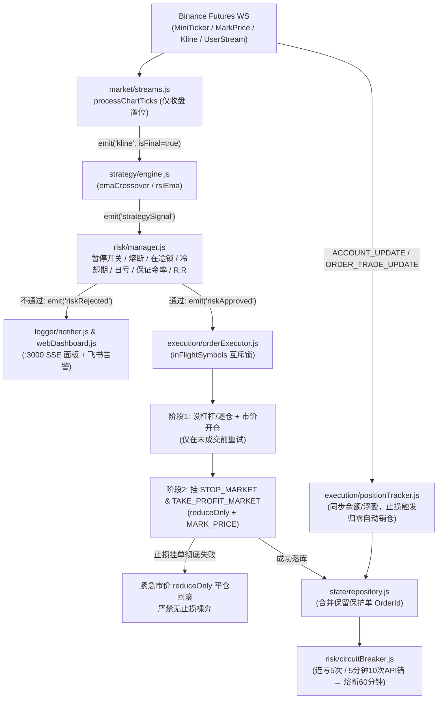

# 系统性架构分析与持续演进台账（System Analysis & Evolution Roadmap）

> **文档定位**：本文档是对 `bianlianghuajianyi`（Binance USD-M 永续合约量化交易系统）的全景式代码级体检、架构梳理与分阶段演进台账。  
> **维护原则（完成哪里记录哪里）**：后续每一次功能开发、Bug 修复或策略迭代，均以本文档第 5 节的 **Master Checklist** 和第 6 节的 **迭代完成记录表** 为唯一进度真源——**改完一处、测通一处（`npm test`）、勾选一处（`[ ]` → `[x]`）、登记一处**。

---

## 1. 项目全景与双轨架构解析

本项目实际上由**两套既共享基础策略契约、又相互独立的子系统**构成：

| 维度 | 轨道 A：实时自动交易引擎（Runtime Bot） | 轨道 B：离线量化研究与验证框架（Research Engine） |
|---|---|---|
| **入口命令** | `npm start` / `npm run start:dry` (`src/index.js`) | `npm run research` (`src/research/cli.js`) / `scripts/*.js` |
| **核心目录** | `src/{market,strategy,risk,execution,state,logger}`、`public/` | `src/research/{backtest,data,funding,metrics,diagnostics,strategies}` |
| **运行模式** | 事件驱动（`EventEmitter` 单例总线 + WebSocket 实时流） | 确定性批处理（严格无前视偏差 Next-Bar Open 撮合模拟） |
| **持久化方式** | 内存态真源 + `data/*.json` 原子写入（每 30s 及退出时） | CSV 官方历史归档 + `manifest.json` SHA256 溯源锁 + Markdown 报告 |
| **当前主力策略** | `emaCrossover`（9/21 EMA）、`rsiEma`（15m 周期，仅做多） | V4 冻结候选策略 `breakout24h4h`（4h 周期 24h 高点突破 + EMA50 过滤） |
| **成熟度评估** | 核心致命 Bug 已于 Phase 0 清零；安全鉴权与订单对账待加固 | **极高**（已通过跨资产外部验证、23,292 条真实资金费率校验与防窥探门禁） |

### 1.1 目录与模块职责矩阵

```text
bianlianghuajianyi/
├── src/
│   ├── index.js                 # 运行时总编排：配置加载 → 状态恢复 → 实盘确认 → 账户同步 → 模块挂载 → 优雅退出
│   ├── config.js                # 环境变量解析、范围/枚举强校验与冻结（Object.freeze）
│   ├── eventBus.js              # 全局事件总线（解耦行情、策略、风控、执行与监控）
│   ├── market/                  # 行情接入层：币安 USD-M WebSocket 流管理、K线收盘判定（processChartTicks）、自动重连
│   ├── strategy/                # 实盘策略层：engine 路由 + emaCrossover / rsiEma（纯函数 computeSignal 与实时 onTick 分离）
│   ├── risk/                    # 事前/事中风控层：在途互斥、信号冷却、日亏损上限、持仓上限、保证金率>=200%、R:R>=1:1、熔断器
│   ├── execution/               # 交易执行层：杠杆/逐仓设置、市价开平仓、STOP_MARKET/TAKE_PROFIT_MARKET 保护单、失败自动平仓回滚、WS账户同步
│   ├── state/                   # 状态存储层：内存单真源（database.js）+ 读写仓储封装（repository.js）+ JSON 原子落盘
│   ├── logger/                  # 可观测与交互层：文件日志、终端仪表盘、:3000 Web SSE 面板、飞书告警与双向指令控制
│   └── research/                # 量化投研层：CSV清洗校验、15m→1h/4h UTC重采样、滑点/手续费/真实资金费率回测、Walk-Forward、2026 Holdout锁
├── public/dashboard.html        # 零依赖原生 Canvas + SSE 实时监控与命令下发前端
├── docs/                        # 架构分析、接口端口速查（API_AND_PORTS.md）、投研预注册协议与审计报告
├── reports/                     # 各阶段量化回测、资金费率归因与外部验证产出报告
└── tests/                       # 基于 node:test 的 20 个测试套件（回测数学证明、策略一致性、运行时风控执行回归）
```

### 1.2 实时信号与风控执行流转图



---

## 2. 端口记忆卡与核心接口速查

> 完整请求体、事件载荷结构详见同级文档 [`docs/API_AND_PORTS.md`](./API_AND_PORTS.md)。

### 2.1 必记端口与外部端点

- **本地 Web 监控面板 & 命令/飞书回调统一端口**：**`3000`**
  - 访问地址：`http://localhost:3000`
  - 配置变量：`WEB_PORT=3000`（定义于 `.env` / `src/config.js`，启动时控制台自动打印）
- **币安测试网（默认安全环境 `BINANCE_TESTNET=true`）**：
  - REST：`https://testnet.binancefuture.com/fapi/` (`443`)
  - WS：`wss://stream.binancefuture.com/stream` (`443`)
- **币安实盘（`BINANCE_TESTNET=false`）**：
  - REST：`https://fapi.binance.com/fapi/` (`443`)
  - WS：`wss://fstream.binance.com/stream` (`443`)

### 2.2 本地 `:3000` 暴露的 5 个 HTTP / SSE 接口

| 方法 | 路径 | 用途 | 鉴权现状 |
|---|---|---|---|
| `GET` | `/` | 加载 `public/dashboard.html` 实时可视化监控台 | 无（默认仅 `127.0.0.1` 可达） |
| `GET` | `/api/state` | 拉取行情、持仓、当日盈亏、信号日志、熔断器快照 JSON（含 `authRequired`） | 无 |
| `GET` | `/api/stream` | SSE 实时推送最新逐笔价格与分时曲线 | 无 |
| `POST` | `/api/command` | 执行控制指令（`/status` `/positions` `/close SYMBOL` `/pause` `/resume` `/strategy` `/help`） | ✅ `Bearer <DASHBOARD_ADMIN_TOKEN>`（未配置时仅允许本机回环，远端 `403`）+ `64KB` 上限 |
| `POST` | `/feishu/callback` | 飞书事件订阅回调（`url_verification` 与聊天指令接收） | ✅ `FEISHU_VERIFICATION_TOKEN` 常量时间比对 + `64KB` 上限 |

---

## 3. 全量代码审计：现存深层问题与优化方向

经过对全部源码的逐行排查，除已在 **Phase 0** 直接修复的 9 个致命 Bug 外，项目当前还存在以下 **5 大类结构性问题**，需要在后续迭代中按优先级逐步消化：

### 3.1 安全边界层：`:3000` 管理接口缺乏鉴权与网卡隔离（高优 P1）
- **现状问题**：`src/logger/webDashboard.js` 中 `server.listen(port)` 默认监听 `0.0.0.0:3000`，`POST /api/command` 和 `POST /feishu/callback` 无任何身份校验，且 `readBody(req)` 未限制请求包大小。一旦部署到公网云服务器且防火墙误放行 `3000` 端口，外部攻击者可直接发 `/close` 恶意平仓或发超大包打崩 Node 进程。
- **优化方案**：
  1. 默认绑定本地回环地址 `127.0.0.1`（新增 `WEB_HOST=127.0.0.1`，仅在显式配置时开放局域网/反代访问）。
  2. 新增 `DASHBOARD_ADMIN_TOKEN`，对 `POST /api/command` 强制校验 `Authorization: Bearer <token>`（前端面板支持本地输入并保存在 `sessionStorage`）。
  3. 对 `/feishu/callback` 校验飞书 `verification_token` 或签名头，并为 `readBody` 增加 `64KB` 上限保护。

### 3.2 执行可靠性层：滑点保护、时钟同步与重启挂单对账缺失（高优 P1）
- **现状问题**：
  1. `config.js` 定义了 `MAX_SLIPPAGE=0.005`，但 `orderExecutor.js` 使用纯市价单（`futuresMarketBuy/Sell`），极端插针或流动性枯竭时无最大成交价保护。
  2. `websocket.js` 中 `useServerTime: false`，若服务器系统时钟偏差超过 `recvWindow (15s)`，所有私有下单接口会报 `-1021 Timestamp outside of recvWindow`。
  3. 进程重启后，`syncAccount()` 虽能从 `futuresPositionRisk()` 恢复持仓，但未调用 `futuresOpenOrders()` 重新关联交易所上存续的止损/止盈挂单 ID（甚至若人工在 App 撤掉了止损单，机器人不会自动补挂）。
- **优化方案**：
  1. 开仓支持可配置的“带滑点上限的 `LIMIT` + `IOC`（Immediate-Or-Cancel）”保护模式，真正用起 `MAX_SLIPPAGE`。
  2. 在非离线单测环境下开启币安服务器时间同步或定期校准时间偏移量。
  3. 在 `syncAccount()` 中拉取 `futuresOpenOrders()`，按 `symbol` 自动回填存续的 `STOP_MARKET` / `TAKE_PROFIT_MARKET` 订单 ID；若发现实盘持仓缺失止损单，告警或自动补挂。

### 3.3 投研与实盘断层：最优验证策略 `breakout24h4h` 尚未接入实盘引擎（中优 P2）
- **现状问题**：项目投研层投入了大量心血，严格证明了 15m 均线策略手续费损耗比过高，并筛选出唯一跨越牛熊与跨资产检验的 4h 突破策略 `src/research/strategies/breakout24h4h.js`（Edge/Cost 达 `10.73`）。但实盘 `src/strategy/engine.js` 仍只注册了早期的 15m `emaCrossover` 和 `rsiEma`，研究硕果尚未转化为实盘战斗力。
- **优化方案**：
  1. 为实盘层增加轻量级 `breakout24h4h` 适配器（直接订阅 `CANDLE_INTERVAL=4h` 的 K 线流，或复用 `resampler.js` 将 15m K 线实时聚合为 UTC 对齐的 4h K 线）。
  2. 在 `src/risk/limits.js` 中增加可选的 **ATR 波动率动态止损**（替代单一固定百分比 `STOP_LOSS_PCT`），让高波动山寨币与低波动主流币共享统一的风险敞口。

### 3.4 策略数学精度层：RSI 平滑算法与 EMA 预热窗口偏差（中优 P2）
- **现状问题**：
  1. `src/strategy/rsiEma.js` 中的 `calcRSI` 采用 14 期简单算术平均（Cutler's RSI），而币安与 TradingView 标准图表采用 **Wilder's RMA 递推平滑**，实盘信号触发点会与看盘软件显示值偏离。
  2. `PRICE_BUFFER_SIZE = 60` 对 `EMA(50)` 而言仅有 10 根指数衰减迭代，历史权重尚未完全收敛（注：为保护 `tests/parity.test.js` 锁定的 V1 回测黄金基准，不能直接篡改旧文件常量）。
- **优化方案**：保留 V1 策略用于历史对比，新建 `rsiEmaV2`（或统一使用 `src/research/strategies/indicators.js` 的增量状态计算器），将 K 线缓存扩充至 `250+` 根并采用标准 Wilder RSI。

### 3.5 存储与运维层：文档口径不一致、死配置与容器化缺失（常优 P3）
- **现状问题**：
  1. `README.md` 声称使用 SQLite、`Kelly 公式`、`Telegram 推送`，但实际代码是 JSON 文件全量原子写、固定比例仓位、仅实现了飞书推送（`TELEGRAM_BOT_TOKEN` 为未接线的死配置）。
  2. `trades.json` 虽限制了内存保留最近 1,000 条，但长期高频运行下每 30s 全量序列化 5 个 JSON 文件不如 SQLite WAL 高效且不便按日期/品种做 SQL 统计。
  3. 缺少 `Dockerfile` 与 `compose.yaml` 一键部署编排。
- **优化方案**：先修正 `README.md` 使其与真实代码 100% 诚实对齐；按需补齐 Telegram 推送或清理死配置；后续可选引入 Node 22+ 内置 `node:sqlite` 实现零第三方依赖的 SQLite 持久化，并补充 Docker 部署文件。

---

## 4. 分阶段完善路线图与打卡台账（Master Checklist）

> 📌 **打卡规则**：每完成一个小项，必须附带单元测试或实测验证，确保 `npm test` 零失败后，将 `[ ]` 改为 `[x]` 并在第 5 节追加记录。

### Phase 0：实盘致命隐患清零与工程基线修复（已完成 ✅）
- [x] **P0-1**：修复 `src/market/streams.js` & `websocket.js` 中未收盘 K 线（`isFinal=false`）被提前加入去重集合，导致收盘时被永久丢弃、策略永不触发信号的 Bug。
- [x] **P0-2**：修复 `src/execution/orderExecutor.js` 中 `futuresOrder` 6 参数传参错误及现货订单类型混用问题，改为 5 参数签名 + `STOP_MARKET` / `TAKE_PROFIT_MARKET`（`reduceOnly: true`, `workingType: 'MARK_PRICE'`）。
- [x] **P0-3**：拆分市价开仓重试与保护单重试，消除挂止损报错导致重复市价买入 3 倍仓位的灾难 Bug；增加止损挂单失败自动市价平仓回滚兜底。
- [x] **P0-4**：修复飞书与 Web 面板 `/close <SYMBOL>` 仅删本地内存不向交易所发单的“假平仓”Bug，实现异步真实撤单平仓。
- [x] **P0-5**：修复 `repository.upsertPosition` 覆盖丢失 `stopLossOrderId/takeProfitOrderId` 的问题，兼容币安 WS `ACCOUNT_UPDATE` / `ORDER_TRADE_UPDATE` 结构，止损触发归零时自动销除本地仓位。
- [x] **P0-6**：在 `risk/manager.js` 落地在途订单互斥锁（`isPending`）、`SIGNAL_COOLDOWN_SECONDS` 信号冷却期、实时 `markPrices` 保证金率计算及多空双向对称风控校验。
- [x] **P0-7**：对齐 `circuitBreaker.js` 与 `notifier.js` 的 `circuitBreakerTripped` 事件名，修复熔断飞书告警静默失效问题；让 `EMA_FAST` / `EMA_SLOW` 环境变量在实时策略中真正生效。
- [x] **P0-8**：固定并打印 `WEB_PORT=3000` 端口配置，移除 `package.json` 硬编码本地代理，支持 `CONFIRM_LIVE_TRADING=true` 守护进程启动，整理 `docs/API_AND_PORTS.md`。
- [x] **P0-9**：同步 `manifest.json` 资金费率 CSV 哈希，兼容 Windows CRLF 换行符与离线大体积数据自动跳过，新增 `tests/runtime-execution-risk.test.js` 与 `.github/workflows/ci.yml`，全量测试 `0 fail`。

### Phase 1：接口鉴权与运行期安全加固（已完成 ✅）
- [x] **P1-1**：为 `webDashboard.js` 增加 `WEB_HOST` 配置（默认绑定 `127.0.0.1`），防止公网裸奔 `:3000` 端口。
- [x] **P1-2**：为 `POST /api/command` 增加 `DASHBOARD_ADMIN_TOKEN` 鉴权校验（SHA-256 + `timingSafeEqual`，未配置时阻断非回环远端请求），并在 `public/dashboard.html` 支持输入保存 Token（`sessionStorage`）。
- [x] **P1-3**：为 `POST /feishu/callback` 增加飞书 `FEISHU_VERIFICATION_TOKEN` 校验，并为 `readBody()` 增加 `64KB` 请求体上限保护（超限返回 HTTP `413`）。
- [x] **P1-4**：在 `websocket.js` / `streams.js` 实盘与测试网模式下支持合约服务器时间校准（`syncFuturesServerTime` + 每 30 分钟后台刷新），消除本地时钟偏移导致的 `-1021` 拒单风险且避开现货 451 地域封锁。
- [x] **P1-5**：在 `orderExecutor.js` 中接入 `MAX_SLIPPAGE` 保护（支持按 `tickSize` 对齐的 `LIMIT` + `IOC` 可成交限价单模式，正确处理部分成交真实数量对齐与 0 成交超滑点安全放弃）。

### Phase 2：挂单自愈对账与异常恢复（已完成 ✅）
- [x] **P2-1**：启动时 `positionTracker.syncAccount()` 同步拉取 `futuresOpenOrders()`，自动回填已有仓位的止损/止盈 `orderId` 与触发价，并清除本地陈旧失效的挂单 ID。
- [x] **P2-2**：增加定时对账巡检（Reconciliation Loop，默认每 300s，`RECONCILE_INTERVAL_SECONDS`）：检测交易所实际持仓与本地内存是否一致、持仓是否缺失有效止损单，缺失时自动通过 `ensureStopLoss()` 补挂 `STOP_MARKET` 并触发飞书 `reconcileAlert` 告警。
- [x] **P2-3**：WebSocket 断线重连后发射 `wsReconnected` 事件，自动触发一次全量 `reconcilePositions()` 对账同步（弥补断线窗口期漏推的成交与持仓变更，且保持当日初始本金 `startBalance` 不被覆盖）。
- [x] **P2-4**：细化手续费与已实现盈亏核算：在 `repository.recordOrderExecution()` 实现按 `orderId` 幂等的开仓手续费扣减与平仓 `realizedProfit - commission` 净利结算（支持先 REST 粗算、后 WS 精确回报差额修正，杜绝双倍记账与胜率虚高）。

### Phase 3：打通投研成果与实盘引擎（已完成 ✅）
- [x] **P3-1**：封装 `breakout24h4h` 实盘策略适配器（`src/strategy/breakout24h4h.js`）并注册到 `src/strategy/engine.js`，严格保持 `src/research/strategies/breakout24h4h.js` 冻结源码一字不改。
- [x] **P3-2**：启动预热增强：在 `streams.js` & `websocket.js` 实现 `warmupFuturesKlines`，策略启动时在 WebSocket 建连前主动通过 REST 拉取 `WARMUP_CANDLES`（默认 250 根）历史 K 线进行指标预热并记录去重集合，确保 `EMA50`、24h 极值与实时 ATR 首秒完全收敛。
- [x] **P3-3**：在 `src/risk/limits.js` 扩展 `calculateAtrStopLoss` 与 `calculateAtrTakeProfit`，并在 `src/risk/manager.js` 中打通 `STOP_LOSS_MODE=pct|atr` 动态止损与安全回退。
- [x] **P3-4**：编写 `scripts/check-holdout-readiness.js`，建立 2026 样本外数据就绪度巡检机制与官方数据获取、解封回测指南（配置 npm 脚本 `npm run research:holdout-check`）。

### Phase 4：指标升级、存储演进与部署标准化（待办）
- [ ] **P4-1**：新增标准 Wilder's RMA 平滑的 `rsiEmaV2` 策略（缓存窗口 `>=250` 根），对齐看盘软件指标数值。
- [ ] **P4-2**：补齐 `notifier.js` 的 Telegram Bot 告警推送（或清理未使用的 `TELEGRAM_*` 配置项），修正 `README.md` 中与实际实现不符的描述。
- [ ] **P4-3**：评估使用 Node 22+ 原生 `node:sqlite` 升级状态持久化层，保留历史成交流水查询接口并在 Web 面板展示最近成交记录表。
- [ ] **P4-4**：编写 `Dockerfile` 与 `compose.yaml`（含健康检查 `GET /api/state`、日志轮转与数据卷挂载），支持服务器一键容器化部署。

---

## 5. 迭代完成记录表（Execution Log）

| 日期 | 阶段 / 编号 | 完成内容摘要 | 关键涉及文件 | 测试 / 验证结果 |
|---|---|---|---|---|
| 2026-11-18 | **Phase 0 (P0-1 ~ P0-9)** | 完成全仓库系统性代码审计；修复 K 线去重丢包、合约保护单签名与 3 倍重复开仓、飞书 `/close` 假平仓、WS 账户同步抹除止损单 ID、风控冷却与并发锁、熔断告警事件名不一致、EMA 配置失效及 CSV 哈希不一致问题；建立 `:3000` 端口与接口规范文档及 GitHub Actions CI。 | `src/execution/*`、`src/market/*`、`src/risk/*`、`src/logger/*`、`src/strategy/*`、`src/config.js`、`tests/runtime-execution-risk.test.js`、`docs/API_AND_PORTS.md`、`docs/SYSTEM_ANALYSIS_AND_ROADMAP.md` | `npm test` 通过（20 个测试文件，191 pass / 0 fail / 13 离线大文件自动 skip） |
| 2026-11-18 | **Phase 1 (P1-1 ~ P1-5)** | 完成接口鉴权与运行期安全加固：`:3000` 默认绑定 `WEB_HOST=127.0.0.1`；`/api/command` 接入 `DASHBOARD_ADMIN_TOKEN` 与非回环阻断，前端面板支持 Token 保存；`/feishu/callback` 接入 `FEISHU_VERIFICATION_TOKEN` 与 `64KB` 请求体上限拦截（HTTP 413）；实现合约 `futuresTime()` 服务器时钟校准与定期刷新；`orderExecutor` 接入 `MAX_SLIPPAGE`（`LIMIT` + `IOC`）滑点保护。 | `src/config.js`、`src/index.js`、`src/logger/webDashboard.js`、`public/dashboard.html`、`src/market/streams.js`、`src/market/websocket.js`、`src/risk/manager.js`、`src/execution/orderExecutor.js`、`.env.example`、`tests/phase1-security-execution.test.js` | `npm test` 通过（21 个测试文件，194 pass / 0 fail / 13 离线大文件自动 skip） |
| 2026-11-18 | **Phase 2 (P2-1 ~ P2-4)** | 完成挂单自愈对账与精确净盈亏核算：`syncAccount` 联动 `futuresOpenOrders` 回填存续仓位 SL/TP `orderId`；新增 `reconcilePositions` 定时巡检自动为裸仓补挂 `STOP_MARKET` 并推送飞书告警；WS 断线重连后自动触发 `wsReconnected` 全量对账且保护 `startBalance`；实现 `recordOrderExecution` 按 `orderId` 幂等核算开平仓 `commission` 与 `realizedProfit` 差额修正。 | `src/execution/positionTracker.js`、`src/execution/orderExecutor.js`、`src/state/database.js`、`src/state/repository.js`、`src/market/websocket.js`、`src/logger/notifier.js`、`src/logger/webDashboard.js`、`src/index.js`、`src/config.js`、`tests/phase2-reconciliation-pnl.test.js` | `npm test` 通过（22 个测试文件，197 pass / 0 fail / 13 离线大文件自动 skip） |
| 2026-11-21 | **Phase 3 (P3-1 ~ P3-4)** | 打通投研成果与实盘引擎：封装 `breakout24h4h` 实盘策略适配器（注册到 `strategyEngine`，保持冻结投研源码原样），实时计算并派发 ATR；在 `websocket.warmupKlines` & `streams.warmupFuturesKlines` 实现启动历史 K 线预热与去重；在 `limits.js` & `manager.js` 扩展 `STOP_LOSS_MODE=pct\|atr` 动态止损与优雅回退；编写 `scripts/check-holdout-readiness.js` 实现 2026 样本外数据就绪巡检与解封指引。 | `src/strategy/breakout24h4h.js`、`src/strategy/engine.js`、`src/market/streams.js`、`src/market/websocket.js`、`src/risk/limits.js`、`src/risk/manager.js`、`src/config.js`、`src/index.js`、`scripts/check-holdout-readiness.js`、`package.json`、`tests/phase3-strategy-warmup-atr.test.js`、`docs/API_AND_PORTS.md`、`docs/SYSTEM_ANALYSIS_AND_ROADMAP.md` | `npm test` 通过（23 个测试文件，203 pass / 0 fail / 13 离线大文件自动 skip） |
