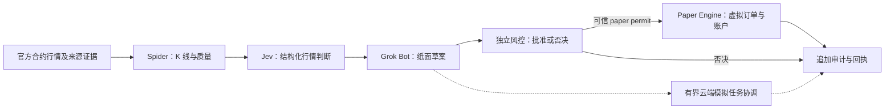

# Quant 2.0 — 三角色架构冻结

日期：2026-10-10（Asia/Shanghai）。状态：`DESIGN_FROZEN / IMPLEMENTATION_PENDING / E2E_NOT_RUN`。本轮只完成源码静态审计、架构、接口契约和分阶段验收标准；保留原代码、原策略、原报告和 Git 历史，不全面重写、不启动新服务。

规范入口：[统一数据契约 v1](DATA_CONTRACTS_V1.md)、[分阶段验收 v1](ACCEPTANCE_GATES_V1.md)、[审计基线](AUDIT_BASELINE.json)。当前项目状态仍以 [PROJECT_STATUS](../PROJECT_STATUS.md) 顶部为准。

## 1. 冻结的唯一职责

| 组件 | 负责 | 禁止承担 |
| --- | --- | --- |
| **Spider** | 不同合约 K 线采集；完整合约身份、周期、OHLCV、交易所时间与数据质量/来源证据 | 行情方向/概率判断、交易草案、仓位计算、风险批准、虚拟或真实订单 |
| **Jev** | 消费 Spider 数据，输出结构化行情方向分类、概率、不确定性、数据有效性与实际模型版本 | 采集或补造价格、交易动作/仓位/止损、订单执行、风控批准、云调度 |
| **Grok Bot** | 消费 Jev 判断及只读代码规则，生成纸面指令草案、关联判断 ID、解释/审计；协调有界云端模拟任务 | 改写行情/概率、独立重新判断方向、计算或修改硬风控规则、发行批准、连接真实交易端点 |
| **独立风控层** | 代码计算资金/数量/保护规则，验证全链证据和当前状态，拥有最终否决；管理代码保护性退出授权 | 模型驱动阈值更改、概率补造、采集、云调度、真实下单 |
| **Paper Engine** | 消费可信风控许可，处理虚拟订单、模拟成交、账户状态、回执与持久恢复 | 行情采集/模型请求/云调度/方向判断、绕过风控、真实 SDK/私有或 testnet 订单接口 |

三角色名称与模型供应商相互独立：Jev 不自动等于 DeepSeek，Grok Bot 名称不自动表示已接 xAI/Grok API。风控与 Paper 是独立基础组件，不并入任一角色。

上述箭头是目标新指令接口边界，不是当前已实现流程。行情和判断的不可变引用同时提供给 Risk；虚拟账户状态只供代码规则与风控使用。已有仓位的代码保护采用独立 `CODE_PROTECTION` 风控→Paper 路径，原判断只作审计引用，不等待 Jev/Grok 重新判断；仍需可信 reduce-only 许可与当前状态检查。云工作者执行相同权限分离的流程，不能以云回调直接把订单送给 Paper。Paper 没有通向真实交易端点的箭头或依赖。

安全不变量：**`LIVE_TRADING=false`、`REAL_ORDERS=0`**。schema/环境/云任务要求开启 live、testnet execution 或真实订单均拒绝，不能以运行模式字符串作为唯一隔离措施。

## 2. 审计基线与事实边界

- 初始 Git HEAD：`f936aba9a526fc970700e01786c50c9b37e50ef9`；已核对最近 15 条提交及仓库交接文件。审计依据包括未提交的实际工作树，不把 HEAD 当全部运行源码身份。
- 初始 tracked dirty：`.gitattributes`、`package.json`、`public/trend-grid/app.js/index.html/style.css`、`scripts/trend-grid-v1.js`。还有已有 `src/paper/`、Trend Grid controller/server/tests 与数据输出等 untracked 内容；本轮保留，不运行或纳入提交。
- `package.json` 只有既有 dotenv/node-binance-api 与 cross-env；本轮没有添加依赖。基线 `npm test` 为 **1124 / 1111 pass / 13 fail / 0 skip/cancel**，13 个既有失败是历史数据缺失/资金费 SHA 欠债；没有全量通过声明。
- 有界检索 `src/scripts/tests/docs/configs` 与既有根说明文件，在新增本文之前没有 Spider/Jev/Grok 名称命中，也没有找到对应 Provider/云任务实现。该结论限于已审计仓库，不否定用户在外部拥有的同名系统。
- 本轮未启动回放、采集、模型请求、云部署或新运行服务；没有解锁或执行 2026 holdout 策略。按 AGENTS 运行的原 npm suite 保留原 acquisition/validator 范围，不能声称所有测试从未接触历史验证 metadata。

## 3. 四个现有集成点及最小适配边界

| 审计点 | 已有源码证据 | 现有能力与缺口 | 后续最小适配；本轮不实现 |
| --- | --- | --- | --- |
| 行情采集 | `src/autonomous/marketCollector.js:35,107` | 筛选官方 USD-M PERPETUAL/USDT，输出 book/mark/24h-volume 快照；不是 OHLCV 窗口，完整合约元数据未进入输出 | 包装独立只读 K 线端口，绑定 instrument/timeframe/source/quality |
| 官方 K 线入口 | `src/autonomous/v4ForwardService.js:13,120`；`v4ForwardAccount.js:69,87,94` | 已订阅/检查 15m/4h/mark、闭合/时间/连续性；回调直接进入策略和虚拟成交，职责混合 | 复用解析校验原则，新增只读 frame→MarketWindow 边界，原 ForwardAccount 保留 |
| 历史数据/聚合 | `scripts/phase8m2-4/history-audit.js:65,122`；`src/research/data/candleRepository.js:63,128`；`resampler.js:23` | 新 audit 核 ZIP/CHECKSUM→CSV 字节一致及严格 16×15m；旧 loader 只给 candle+文件级 quality 且会去重，resampler 自身只数条数 | 严格源/连续性验证后复用冻结聚合器，公开去重/缺口而不伪造完整性 |
| Jev Provider 对应候选 | `src/autonomous/deepseekV4Adapter.js:17,112,313`；`deepseek.js:79,162`；`src/aiTrader/deepseek.js:81` | 现有 schema 是 LONG/SHORT/NO_TRADE、ACCEPT/REJECT/ABSTAIN 或交易 action；均非独立方向概率契约；未找到 Jev Provider | 新端口隔离行情判断，实际 Provider 身份未绑定前维持 UNKNOWN/NO_TRADE |
| 概率证据 | `src/autonomous/evaluationStore.js:195`；`tests/autonomousPaperStore.test.js:137` | 明确 Brier/calibration=null，`CONFIDENCE_IS_NOT_A_DEFINED_OUTCOME_PROBABILITY` | 不能重命名 confidence 为 Jev 概率；目标、时距、概率分布/不确定性方法另行绑定 |
| Grok Bot/云协调 | `src/autonomous/autonomousAgent.js:37,67,96`；`main.js:36,53` | 本机 collect→rank→model→risk→paper 循环，未找到 Grok/云任务协议；当前 V4 使用 ADVISORY | 新草案/任务端口包裹有界编排，明确幂等、deadline、artifact、worker 身份，不部署云 |
| 当前 V4 总线 | `src/autonomous/v4AiPaperPipeline.js:642,666,681` | 先量化规则生成 pending，之后模型 advisory；一个类承担信号、模型、风险、订单/成交，顺序不等同目标三角色 | 保留 legacy 语义，不将整个类改名为某个角色或声称兼容已验收 |
| Paper Engine | `src/autonomous/paperExecutor.js:48,51,96,122,129,167` | 本地 broker/WAL/状态哈希/幂等/恢复；风险只接普通 allowed 对象，保护性 close 由 engine 发起；需要真实报价/深度输入 | 复用本地经济/日志原语；新增可信、绑定草案/判断/账户/期限的独立风控许可；保护出口也受代码风控授权 |
| 独立风控 | `src/autonomous/riskEngine.js:22`；`v4AiPaperPipeline.js:41,690`；`v4AiPaperPolicy.js:116` | 已有资金/仓位/亏损/质量、异步后再验/去重及代码保护；不同账户/profile 语义不同 | 规则值保持；在边界外发行最终裁决，不能合并账户或以模型自定尺寸替代 |

## 4. 必须保持的语义与入口隔离

1. **三种行情不能混用。** `providers/canonical.js:42` 的 Kraken 数据明确现货 USD/ENGINEERING_SMOKE_ONLY/SEMANTIC_EQUIVALENCE_FALSE；`v4AiPaperPipeline.js:476` 的 ticker 聚合 `volume=null`、`OBSERVED_POST_START_TICKER_LAST_PRICES` 不是官方合约 OHLCV。历史归档完整也不等于当前行情就绪、实时 warmup 或前瞻验收。
2. **K 线不能变成盘口。** `paperExecutor.js:110,132` 需要真实 bid/ask/depth/mark/funding。仅有 OHLCV 时使用经过登记的既有 bar 模拟原语和真实下一 bar open，不能造盘口；不同引擎的会计/成本/时间规则不得拼接。
3. **冻结策略不能成为新的 Jev 概率模型。** V4 SHA `2e866b3fd4f0b38f0570ab31c9dfc77e1030c5a8` 保持不变；原 LONG/CLOSE/HOLD 与新方向分类不同。新草案只引用既有策略证据与规则，未绑定映射即 NO_TRADE，不新增策略/参数/阈值。
4. **仅检查 deny stub 不足以隔离交易。** `src/exchange/LiveAdapter.js` 是 deny stub，但 `src/minimal/main.js:17` 可选 TestnetAdapter，`src/exchange/TestnetAdapter.js:19,96` 有私有账户/listenKey/order/test；legacy `src/aiTrader` live transport 也仍存在。目标 Paper 入口依赖图必须排除它们及真实 SDK，而不是删除历史代码。
5. **安全标志现状不是完整目标门。** `src/autonomous/safety.js:5` 已拒绝非 paper/live override，但没有读取 `REAL_ORDERS`；普通 `{allowed:true}` 也没有发行者证明。以上是后续有限适配缺口，本轮没有修复或宣布已强制所有新契约。
6. **保留既有用户回放。** 未跟踪 `src/paper/runReplay.js:9,51` 是独立 10USDT/15x 路径，且会覆盖其旧结果文件；`src/aiTrader/paper.js` 是另一个内存账户。都不运行、不提交、不迁移进新角色、不重置其账户。
7. **旧下载器不作为默认新入口。** `scripts/fetch-binance-um-history.js:147,267` 默认结束日期 auto、没有此轮 holdout 前置门；后续必须使用明确 ≤2025 范围及严格字节来源审计。此次未执行该脚本，也未扫描/读取价格归档。

## 5. 本轮交付与后续停止点

本轮是 A0：冻结角色职责、消息字段、失败语义、权限和分阶段门槛，保存审计基线并更新项目交接。目标接口没有运行实现，首条三角色完整模拟仍 **NOT_RUN**；现有旧链路测试或过去回放结果不能替代它。

后续工作只能是 A1 的最小边界适配和 A2 的单条可复现模拟。先绑定真实官方开发期资料、Jev Provider/录制响应、旧代码规则映射和匹配输入的虚拟执行模型，再按登记门槛跑一次完整流程及必要否决/重复恢复检查。缺失输入保持 INCOMPLETE，不用假模型概率或价格补齐。A2 交付后停止，其他研究/多合约扩展/真实云部署留待新的明确范围。

本轮提交 SHA 在后续 metadata 提交写入 PROJECT_STATUS，避免在同一提交中自引用 SHA。`LIVE_TRADING=false / REAL_ORDERS=0` 始终保持；所有较早失败、未知和阻塞结论保留。
